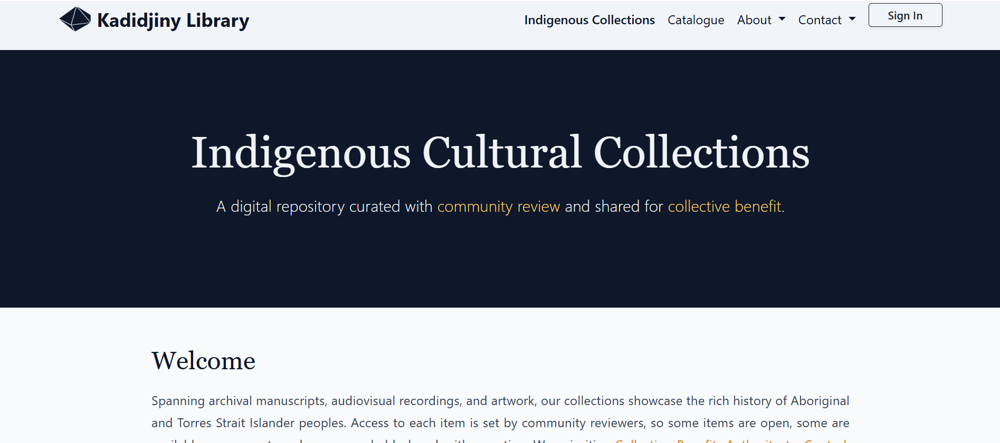
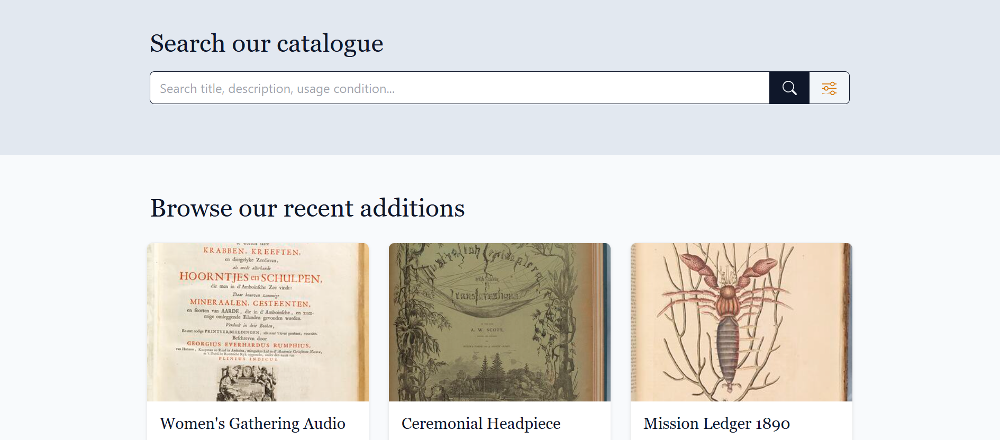
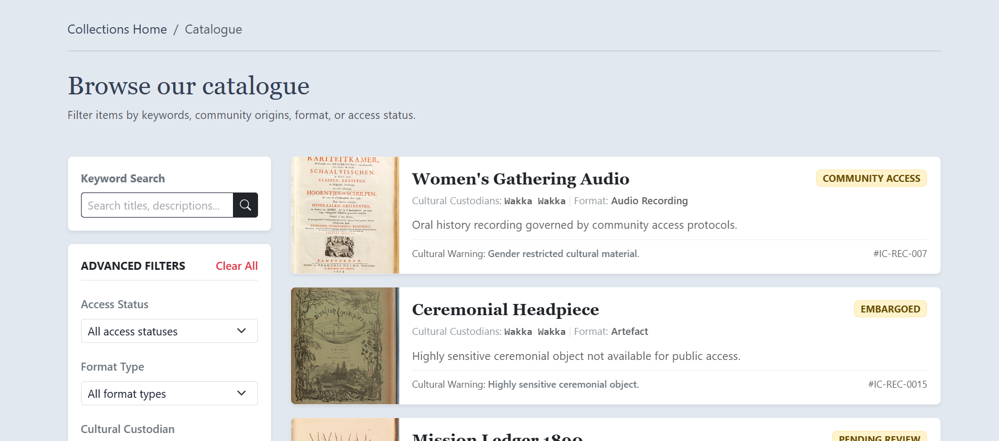
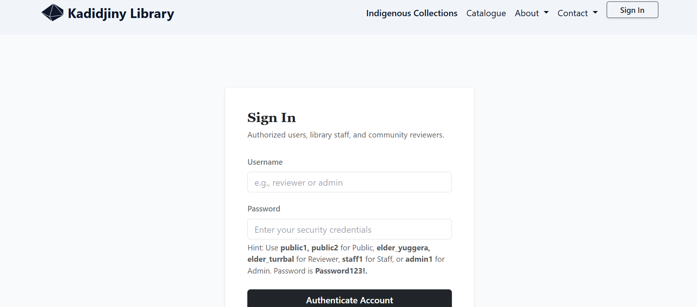
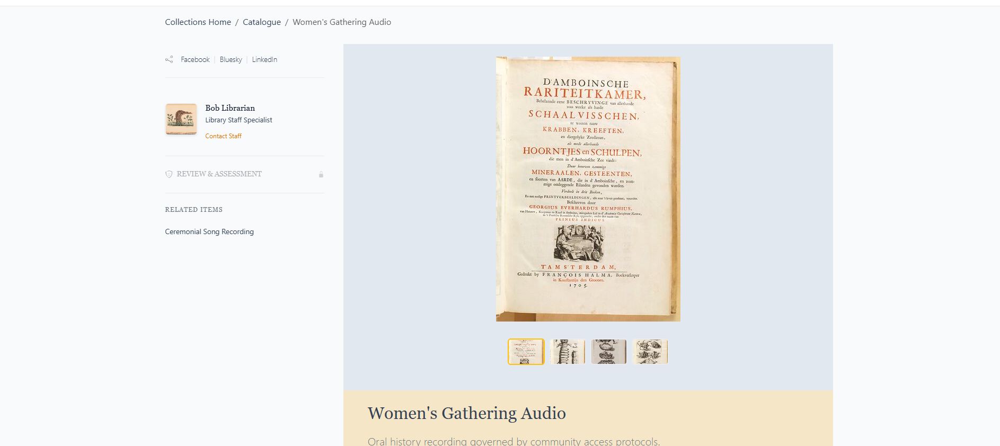
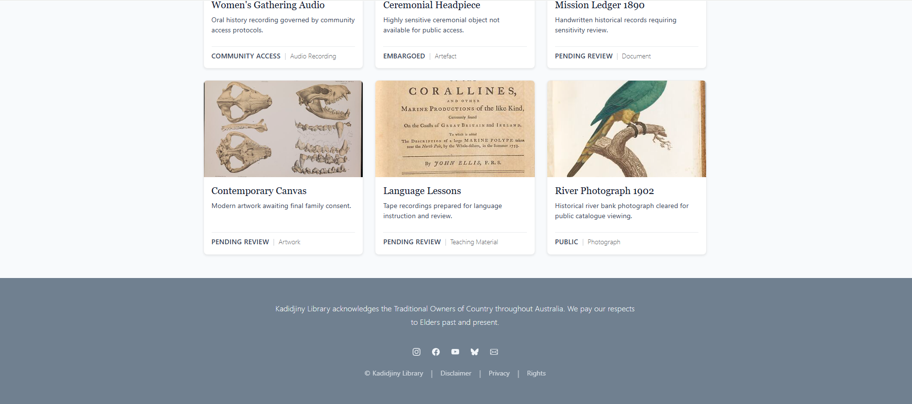
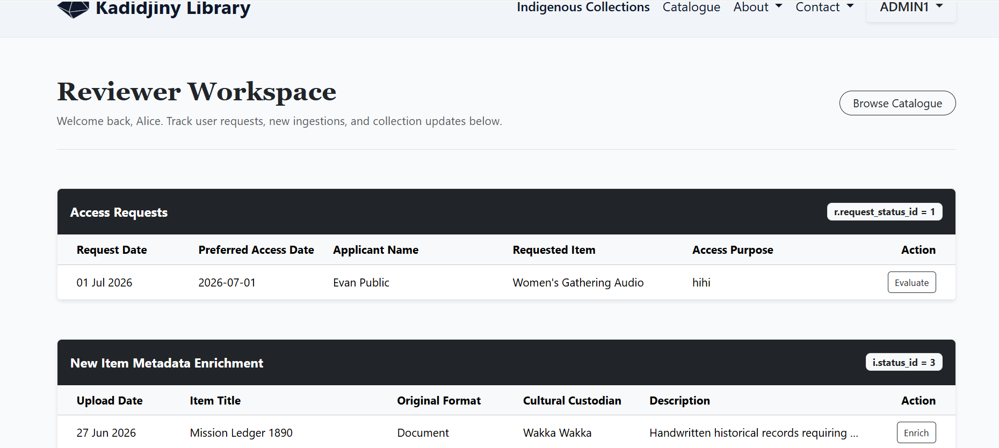
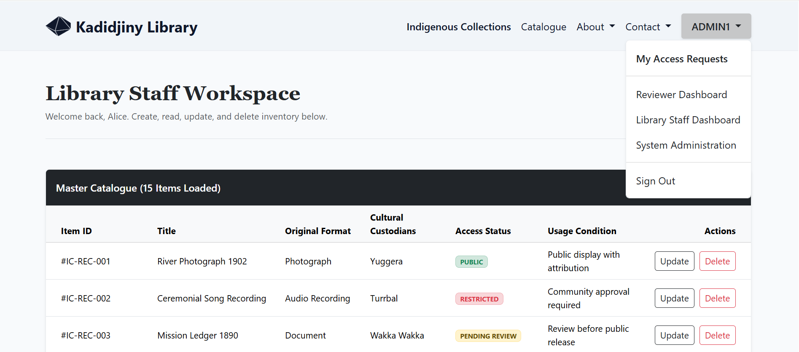

# Indigenous Cultural Collections System – Kadidjiny Library Portal

A Flask-based web application developed as part of a QUT university group project.

The Kadidjiny Library Portal is a digital repository designed to manage Indigenous cultural collections, including archival manuscripts, audiovisual recordings and artwork.

The platform allows users to explore collection items, submit access requests and interact with a role-based review system. Community reviewers can assess requests and manage cultural metadata, while library staff and administrators manage collection records and users.

The system was designed around the CARE Principles for Indigenous Data Governance: Collective Benefit, Authority to Control, Responsibility and Ethics.

## Screenshots

<p align="center">
  
  
  
  
</p>

<p align="center">
  
  
  
  
</p>

## Project Demo

**Video demonstration:** [Watch the project walkthrough]((https://youtu.be/SvczlxdWi9g))

A walkthrough showcasing the main pages, catalogue navigation and application workflows.

## Key Features

- Dynamic collection catalogue with search and filtering.
- User authentication and role-based access control.
- Access request submission and review workflows.
- Cultural metadata management.
- Collection and user administration.
- Form validation and CSRF protection.

## User Roles

| Role | Main Responsibilities |
|---|---|
| Public Researcher | Browse collections and submit access requests. |
| Community Reviewer / Elder | Review requests and manage cultural metadata. |
| Library Staff | Manage collection records and inventory. |
| System Administrator | Manage users and administrative functions. |

## Technologies Used

- **Backend:** Python, Flask, Flask-Login, Flask-WTF
- **Frontend:** HTML5, CSS3, Bootstrap 5, JavaScript, Jinja2
- **Database:** MySQL, Flask-MySQLdb, SQL
- **Architecture:** Model-View-Controller (MVC)

## Local Installation and Setup

Follow these instructions to run the application locally.

### 1. Prerequisites

Install:
- Python 3.10 or later
- MySQL Server 8.0 or later
- MySQL Workbench

### 2. Clone the Repository

```bash
git clone YOUR_REPOSITORY_URL
```

Alternatively, download and extract the repository as a ZIP file.

Open the project folder in Visual Studio Code.

### 3. Create a Virtual Environment

Open a terminal in the project directory:

```bash
python -m venv venv
```

Activate it on Windows:

```powershell
venv\Scripts\activate
```

### 4. Install Dependencies

```bash
pip install -r requirements.txt
```

### 5. Configure the MySQL Database

1. Open MySQL Workbench and connect to your local MySQL Server.
2. Open the `database.sql
